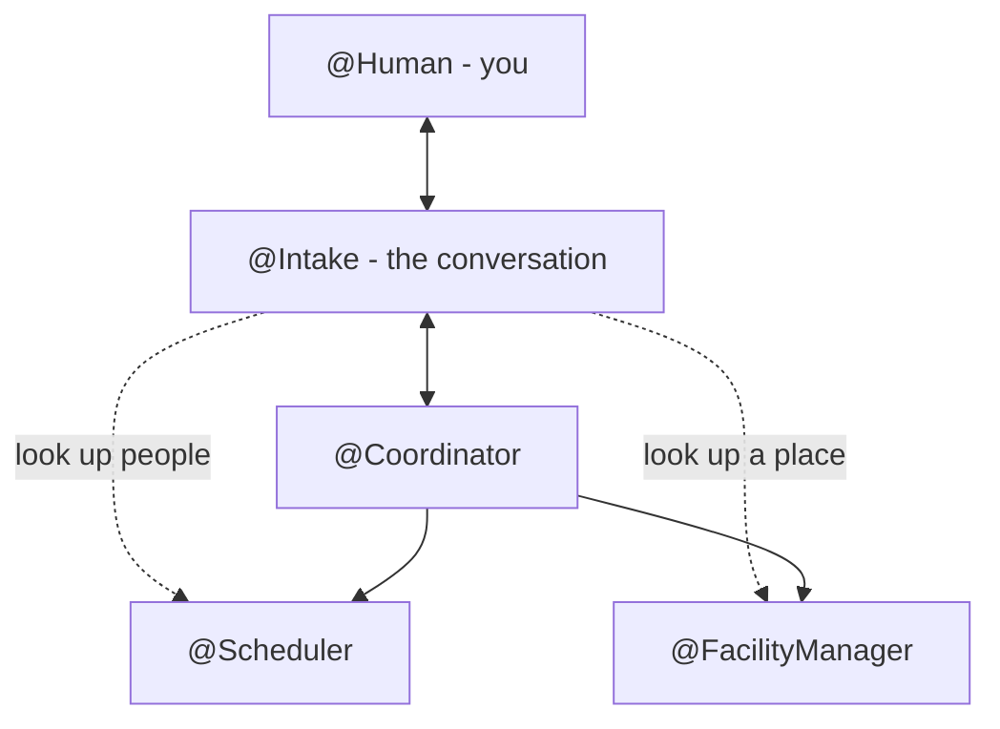

# The conversation

## What it is

Instead of filling in the form you can just say what you want: *a design review with Sanne and
Daan on Tuesday, somewhere in nature, no lunch.* One more agent, **`@Intake`**, holds that
conversation. It works out who you mean, asks when something is unclear, and then sends the team
exactly the request the form would have sent. After that it keeps you company: it passes the
team's questions to you, and tells you in words what happened.

Behind it is the same team, unchanged. The coordinator still decides every step, and the two
questions are still answered on their cards - never in the chat.

> **The one sentence to keep:** *the model listens; the coordinator decides; the human approves.*

## How it works

### Where it sits

`@Intake` stands between you and the coordinator. The coordinator is configured to treat it as
its human, so every question and outcome goes to `@Intake` first. It can ask `@Scheduler` and
`@FacilityManager` one kind of thing each - *who is this?* and *which place is this?* - and that is
all it can ask anyone.

### Its tools

The model gets five tools, and nothing else:

| Tool | What it does |
|---|---|
| `look_up_people` | asks `@Scheduler` who *Sanne* and *Daan* are |
| `look_up_place` | asks `@FacilityManager` which place *the meadow room* is |
| `plan_meeting` | sends the typed request to the coordinator - once |
| `cancel_meeting` | calls the meeting off |
| `remember` | keeps something you said for next time ([memory](memory.md)) |

There is no tool to book, and no tool to approve.

### From words to a request

1. **Names become people.** `@Intake` looks every participant up. One match settles the name, in
   code; several matches or none come back to the model as a question to put to you - *who do you
   mean?* A name is never guessed into an email.
2. **You count.** You are logged in, so `@Intake` knows who it is talking to. You are not looked
   up, and you attend unless you say otherwise.
3. **A place is described, not chosen.** *Somewhere in nature* goes into the request as words.
   Choosing is the facility manager's job, because it is the only agent that sees the places.
4. **The request goes out, once.** Code checks it first: every participant must be someone a
   lookup settled, and a conversation that already requested its meeting is refused a second
   one. `@Intake` says in one sentence what it asked for.

### The relay

When the coordinator asks about the time, `@Intake` passes the question on to you as a fresh
message - a new copy addressed to `@Human`. That is what lets the planner show it as a card and
the server route your answer: it finds a question by its id, and answers it to whoever asked. Your
answer comes back to `@Intake` and goes to the coordinator unchanged. This is code; the model
does not touch it.

The model does hear about it. Every relayed message is also an *update* for the model, so it can
explain what is on your screen, and at the end say what was booked.

### What the model may say, and to whom

The model may write only to you. A rule on its output - `TalkOnlyToHuman` - refuses any other
recipient. Free text to the coordinator would be ignored, and free text to a specialist would
reach that specialist's model and its booking tools.

Typing *the second one* or *just book the ten o'clock* in the chat is understood, and authorises
nothing. In a live run the model answered: *"I can't choose or approve a time for you. Please
select 10:00-11:00 in the question on your screen."*

## Why it is built this way

**Easier input, not a model in charge.** The goal was a nicer way to ask for a meeting. A model
that ran the saga would have been more flexible - and harder to trust, test and explain, for no
gain in what you can ask for. So the model is put where language is: in front of the team, turning
words into the typed request the coordinator already understood. The team behind it did not
change. ([`design_chat.md`](design/design_chat.md) I1, Appendix A.)

**The human approves, by construction.** Approving is not something the model is asked not to
do; it is something it has no tool for. The questions are answered on their cards, and the
conversation is only ever words. (I4.)

**Code settles what code can.** A lookup with one match is settled by code, not by the model
reading the answer. A request with an unsettled email is refused by code. The model is left
with what needs it: reading your sentence, and asking a good question when something is unclear.
(I3, I11.)

**Ask the agent that knows.** `@Intake` cannot see the places or the people. It asks the two
specialists that can, with typed questions and typed answers - a list of matches, or *nobody by
that name*. Free text to a specialist would reach its booking tools. (I10, I12.)

**One conversation, one meeting**, as one team is one meeting. A different meeting is a new
conversation. (I8.)

### A lesson from building it

The relay had to make a *copy* of each question. The coordinator's question is addressed to
`@Intake`, and the server answers a question to whoever it was addressed to - which must be a
person's proxy, not an agent. Forwarding the original would have put a question on your screen
that could not be answered. So `@Intake` sends a fresh one, addressed to `@Human`, and pairs the
answer up with the original itself. A test answers both: the copy books the meeting, the original
is refused.

A second one, from the live runs: after relaying a question the model usually said nothing,
because the card on the screen already spoke for itself. Narrating every step costs a model
call and rarely adds a line.

## What it does not do

- **Change the request afterwards.** *Make it Thursday* after the request means a new
  conversation (Q2 in the design).
- **Approve or book anything**, as above.
- **Guess a person.** An unknown or ambiguous name is a question to you.

## Where in the code

| File | What is there |
|---|---|
| `agents/src/meeting_agents/intake.py` | `@Intake`: its tools, the checks, the relay, `TalkOnlyToHuman` |
| `agents/catalog/meeting-planner-chat/` | the chat team, which reuses the form team's agents |
| `agents/catalog/meeting-planner-chat/prompt/intake_prompt.yaml` | `@Intake`'s prompt |
| `gui/src/pages/ChatPage.tsx` | the *Talk to the planner* tab |
| `agents/tests/test_intake.py` | the relay, the refusals, and what the model is told |

The design: [`design_chat.md`](design/design_chat.md).

---

*Last checked against the code: 2026-11-03, `e662b7c`.*
