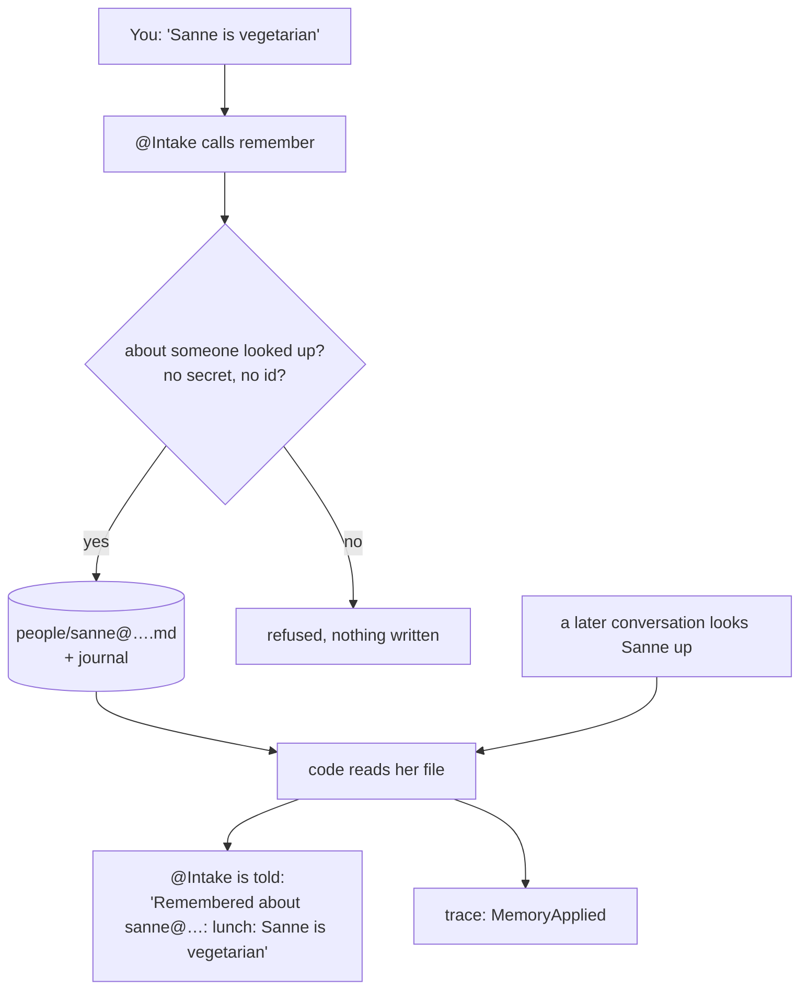

# Memory

## What it is

One team arranges one meeting and is then gone. Without memory, everything you told it is gone
with it: who you mean by *my team*, that your stand-ups last half an hour, that Sanne is
vegetarian, that the meadow room is too noisy for a workshop. Next time you would say it all
again.

Memory is what outlives the team. It is a handful of plain text files that a person can read,
each item saying what was said, by whom, about what and in which conversation - and every change
to them is recorded, so nothing is overwritten without a trace. When a later conversation needs
something, the agent is shown it as *what someone said before*. It is never an order.

There are four kinds, each in its own place:

| Kind | Example | Who reads it |
|---|---|---|
| **Yours** | who *my team* is, how long your stand-ups last | only your own conversations |
| **About a person** | Sanne is vegetarian | anyone's conversation that settles who Sanne is |
| **About a place** | the meadow room is too noisy for workshops | the agent that chooses places, for everyone |
| **Your place preferences** | focus sessions go to the Library | your conversations, which put it in the request |

## How it works

### From a sentence to a file

You tell the planner something worth keeping: *Please remember that Sanne is vegetarian.* The
conversation agent, `@Intake`, has one tool to store it, `remember`, with four parts: is it a
fact or a preference, who or what it is about, the situation it applies to (*lunch*), and the
words themselves.

Before anything is written, code checks it:

- **About whom?** About *you*, someone this conversation has looked up, or a place it has looked
  up. *Remember that Bram likes tea* is refused until Bram has been looked up - so a guessed email
  never becomes a fact about a stranger. A place is filed under the id the location service gave
  it (`meet-nature`), which only the facility manager can find, so `@Intake` asks it first.
- **Is it safe to keep?** Anything that looks like a password, a key, a token or a long number -
  a booking id - is refused, and nothing is written.

What passes is written at once, as **confirmed**: it is what you said, so there is nothing to
review. If an item for the same situation already exists - your stand-ups were 60 minutes, now
they are 30 - the new one replaces it in the file, and points back to the one it replaced.

### Where it is kept

```
/data/workspaces/
  <your email>/_id/memory/organiser.md        yours, and your place preferences
  _shared/_id/memory-shared/people/<email>.md about a person
  _shared/_id/memory-shared/places/<id>.md    about a place
```

Two trees: one per person, one shared. Each item is a short block of fields followed by the words
themselves:

```
---
kind: fact
scope: person:sanne@rag4p.org
situation: lunch
said_by: jettro@rag4p.org
evidence: conversation 5210988d-…
---
Sanne is vegetarian.
```

Beside each tree is a **journal**: a git repository that records every change, with the agent
that wrote it. The file holds what is true now; the journal holds every earlier version. A change
made by hand, outside the planner, is recorded too, as *out-of-band*.

### From a file to a model

This is the part that matters most. **Code decides which items an agent sees, and when - not the
model.** No agent can search memory, and none has a tool to read it. Instead, at a few fixed
moments, code reads the files and puts what applies into the agent's instructions:



The moments are:

| What | When | Who sees it |
|---|---|---|
| your own items | always, in every turn of your conversations | `@Intake` |
| what is known about a person | when a lookup settles who they are | `@Intake` |
| what is known about a place | when `@Intake` looks a place up | `@Intake` |
| what is known about all places | before a location is chosen | `@FacilityManager` |
| what is known about the chosen place | before a room there is booked | `@FacilityManager` |

Each time, the items are labelled as remembered from earlier conversations, and not as an
instruction. And each time, a **`MemoryApplied`** event goes into the trace, naming the agent,
the reason - *a lookup settled sanne@…*, *choosing a location for "somewhere quiet"* - and the
items. *How did it know?* always has an answer.

Your place preferences take one more step. They are among your own items, so `@Intake` sees them
always; when you ask for a focus session, it puts *the Library, as remembered for focus sessions*
into the request it sends. The facility manager then reads that in the wish, like anything else
you asked for. A remembered meal works the same way: *lunch for "Workshop": soup* fills the lunch
wish when you ask for a workshop and say nothing about lunch, and `@Intake` says so - *"with
soup, as remembered for Workshop"* - so the lunch question is not asked.

### Suggestions: what you keep repeating

The planner also **offers** to remember things, so you have less to say every time. Two kinds,
for now:

- **a team** - the same people in two or more of your meetings: give them a name, and next time
  *the review crew* is enough;
- **a meal** - meetings with the same title that had a lunch wish twice: remember it, and it is
  filled in next time.

They are offered in two places. **On the Memory tab**, code works them out from your own
earlier meetings - the records the Meetings tab reads - each time the page opens; nothing is
stored until you answer. *Remember this* writes it to *Mine* as said by you; *Not now* is kept
in a file beside yours that no agent reads, so the same offer is not made again. **In a
conversation**, once the meeting is booked - when you have seen the place and the lunch - code
invites `@Intake` to offer one thing, the most useful one it does not remember yet: where this
kind of meeting goes, its lunch, lunch with these people, or these people as a team. *"Your
design review is booked … in the study room at the Library, with three soups; shall I remember
the Library for design reviews?"* It remembers only on a clear yes. When there is nothing new to
remember, it says that too - *"Nothing new to remember from this one."* It offers nothing about the
time: a request cannot carry a preferred time yet, so a remembered one could not be used.

A suggestion is a question, never a conclusion: nothing an agent noticed is used until you said
yes to it.

### The memory keeper: tidying what piled up

Over time *Mine* fills up: the same thing said twice, an old item a newer one contradicts, words
that read as an order. **Tidy up**, beside *Mine*, starts the memory keeper - one agent, `@Keeper`,
in a team of its own, owned by you. Code puts your items in front of it; it may propose at most
five changes, each with a reason you can check:

| Proposal | When |
|---|---|
| **merge** | two or more items say the same thing - one item replaces them |
| **retire** | a later item contradicts it, or it is plainly out of date |
| **reword** | it is unclear, or says an order where a fact is meant |

Code drops any proposal that does not hold - an item that is not yours, a merge of one item,
words memory would refuse, something you declined before. What is left is written to a file
of its own, beside yours, that nothing applies. The page shows each one with the items it would
change struck through; **Accept** changes *Mine* the way an edit or a delete would, as you, and
**Not now** keeps it from being proposed again. The keeper reads only *Mine* - never what anyone
said about other people or places.

### Seeing it, and changing it

The planner's **Memory** tab shows four lists: *Mine*, *About me* - what anyone said about you -
*Said by me* - what you said about other people - and *Places*. Each item says who said it and
when, links to the conversation if it was yours, and opens its history: the earlier versions,
read from the journal.

You can **edit** or **delete** what is yours to change:

| List | Who may change it |
|---|---|
| Mine | you |
| About me | you - it is about you, whoever said it |
| Said by me | you, and the person it is about |
| Places | whoever said it, and an admin |

An edit is a new version: the old words stay in the history, and the item now says *changed on
the Memory page by you*. The same checks apply as when the planner remembers something - no
secrets, no ids. A delete stops the item being used at once; its earlier versions stay in the
journal, so deleting is not erasing. The server checks every change against who is logged in,
and the journal records it under that person's name - so the history says who changed what,
whether it was an agent or a person on this page.

The akgentic console's workspace tab shows your own tree as files. The shared tree is only on the
Memory tab: the framework never serves a shared path to a browser.

## Why it is built this way

**Memory is evidence, not authority.** A remembered item can be out of date, or wrong, or said by
someone else. So it is shown as *what was said before*, and the agent weighs it - it does not
obey it. Memory can change what an agent is *told*; it never approves a time, books a room or
answers one of your questions for you. The parts that keep the team safe - the two questions to
you, and each agent reaching one service - do not read memory at all. (M8.)

**Code chooses what applies, because relevance is not likeness.** A search would find items that
*look like* the request. What matters is whether an item *applies*: is it about this person, this
place, this organiser, and is it confirmed? Those are facts code can check, at the moment it
knows them - a lookup has just settled who Sanne is; a location is about to be chosen. It also
means the agent cannot fail to look, and that every use can be logged. With a handful of files
there is nothing a search would add. (M3, M18.)

**Each agent sees only what its job needs.** The facility manager is the agent that can book a
room, so it gets facts about places and nothing else - never what you said about yourself or
about a person. `@Intake` holds the conversation, so it gets yours and those about the people and
places it looked up. (M19.)

**Only what was said, written at once.** A correction should stop the same mistake next time,
not after a review. So what you say is kept as you said it, through one narrow tool that checks
who it is about and refuses secrets and ids. What an agent *concludes* on its own is a different
thing - a guess, not a statement - and is not written at all yet. (M4, M6.)

**Plain files with a journal, because a person must be able to read it.** Managing memory means
explaining it: where an item came from, what it replaced, why it was used. A file you can open,
with a history of who changed what, answers that without a database or a special viewer. It is
also the only kind of store in akgentic that outlives a team and belongs to a person. (M1, M16.)

**Turned down:** the `Memory` notebook of `pydantic-ai-harness`, where the model writes and reads
notes freely - good for an agent's scratch notes, but it has no notion of *confirmed* and leaves
the choosing to the model; and akgentic's knowledge graph, which belongs to a team and is gone
with it. ([`design_memory.md`](design/design_memory.md) §5.)

### A lesson from a live run

Someone remembered *for a sportive environment, choose Campus*. The facility manager was shown
it, and chose Meeting in Nature anyway, because that place's description mentions outdoor
activities and Campus's does not. The memory had been introduced as something to *weigh with the
descriptions* - and a one-line description won. It is now introduced as first-hand knowledge the
descriptions may lack, which counts for more when it speaks to the request; and the agent must
say in its reason whether it followed it. The next run chose Campus, and said why.

Two things to take from it: how memory is *framed* in a prompt decides how much it counts; and a
memory written as an order (*choose Campus*) is weaker than one written as a fact (*Campus has
sport facilities*), because the prompt tells the model not to take orders from memory.

## What it does not do

- **Erase.** Deleting takes an item out of memory, not out of the journal's history (M25 - the
  first thing to add before real names go in).
- **Learn on its own.** Nothing is remembered that nobody said yes to - not a suggestion, not
  the memory keeper's proposals.
- **Tidy the shared lists.** The keeper looks only at *Mine*; what is said about people and places
  has more than one reader, and whose yes would count is a rule still to make (Q14).
- **Remember meetings.** What happened in earlier meetings - *last time the Library was full* - is
  in their records, not in memory. Using it is a later step (M5).
- **Forget by itself.** An item stays until it is replaced. There is no expiry yet (Q5 in the
  design).
- **Keep secrets, ids or anything about strangers**, on purpose.

## Where in the code

| File | What is there |
|---|---|
| `agents/src/meeting_agents/memory.py` | the item, the files, the refusals, writing, the always block, `MemoryApplied` |
| `agents/src/meeting_agents/intake.py` | `remember_said` and its checks, and what a lookup brings along |
| `agents/src/meeting_agents/specialists.py` | `FacilityManager._place_facts`: the facility manager's selection |
| `agents/src/meeting_agents/messages.py` | `remembered_block`: how place facts are worded for the model |
| `server/src/meeting_server/memory_page.py` | `/me/memory`: the four lists and their history; who may change what; edit and delete, written as an agent writes; suggestions from your own meetings |
| `agents/src/meeting_agents/keeper.py`, `agents/catalog/memory-keeper/` | the memory keeper: its team, its checks, its prompt |
| `gui/src/pages/MemoryPage.tsx` | the Memory tab |

The design, with every decision and what was turned down: [`design_memory.md`](design/design_memory.md).
To show it: act 5 of the [demo script](demo.md).

---

*Last checked against the code: 2026-11-03, phase 3c.*
