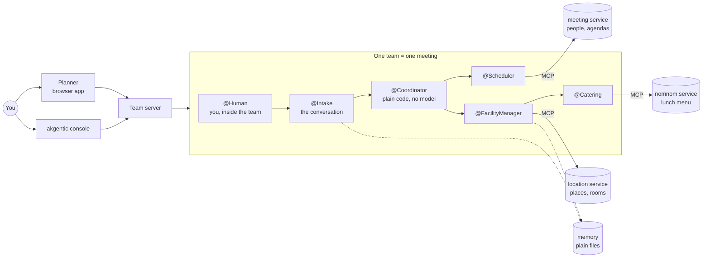

# Overview

## What it is

A meeting planner run by a small team of AI agents. You say who should meet, on which day and
roughly where - in a form, or in your own words - and the team finds a time everyone is free,
chooses a place, books a room, puts the meeting in everyone's agenda and orders lunch. It stops
to ask you to approve the time and place, and about lunch unless you already said. Nothing is
booked before you have answered.

It is a sample, built to learn from. The meeting planner itself is ordinary on purpose, so that
what is interesting stands out: how work is split between code and models, how agents are kept
to what they may do, how a human stays in charge, and how a team can remember without memory
turning into a set of hidden instructions.

It is built on [akgentic](https://github.com/b12consulting/akgentic-framework), a Python
framework in which agents are actors that send each other typed messages. It started as a
rewrite of an older Java project; [`design.md`](design/design.md) has that history.

## The pieces

From the bottom up:

- **Three ordinary services.** People and their agendas, places and their rooms, a lunch menu.
  Each has its own database, a REST API, a small web page, and an *MCP server* - a narrower set
  of tools meant for agents to call.
- **The team.** Four agents arrange the meeting; a fifth, `@Intake`, holds the conversation when
  you talk instead of filling in the form. Each specialist can reach exactly one service.
  `@Coordinator` is not a model at all: it is plain code that knows the order of the steps.
- **The team server.** It runs teams, keeps every message they send, lets a stopped team be
  revived, and knows who you are. It is akgentic's own server, configured rather than written.
- **Two browsers onto it.** The planner shows the *meeting*: the form, the conversation, the two
  questions, a readable trace, your meetings and your memory. The akgentic console shows the
  *team*: its agents, what each model was given, and what it cost.
- **Memory.** Plain files that outlive the team, with a history of every change. Only `@Intake`
  and `@FacilityManager` read them, and each only the part it needs.

## One meeting, start to finish

1. **You ask.** In the form, or to `@Intake` in your own words: *a design review with Sanne and
   Daan on Tuesday, somewhere quiet*. `@Intake` looks the names up - it never guesses an email -
   and turns the conversation into the same typed request the form sends.
2. **A place is chosen.** `@Coordinator` asks `@FacilityManager` which location fits *somewhere
   quiet* for three people. It reads the descriptions, and what people remembered about places.
3. **Times are found.** `@Scheduler` asks the meeting service when everyone is free.
4. **You approve the time.** The question comes to you with the place and why it was chosen.
   Approving the time approves the place. Nothing is booked yet.
5. **You answer about lunch**, in your own words: *something vegetarian, no bread*, or *no*.
   If the request already said - *no lunch* - this question is skipped.
6. **It is booked.** `@Scheduler` puts the meeting in everyone's agenda; `@FacilityManager` books
   a room and has `@Catering` order the lunch.
7. **You are told what happened**, including which lunch actually arrived.

If a step fails, what was already booked is listed so it can be released. Cancelling later
releases the lunch order, the room and the meeting, in that order.

## Why it is built this way

These are the ideas that carry over to other projects. Each has its own page, and its design
records the alternatives that were turned down.

**Code where the answer is known, a model where judgement is needed.** The order of the steps,
what to undo when one fails, when to ask the human - the system knows all of that, so
`@Coordinator` is plain code and can be tested like code. Models do what needs reading and
judgement: matching *somewhere quiet* to a place, *no bread* to a menu, a conversation to a
request. ([`design_akgents.md`](design/design_akgents.md), D1.)

**Each agent reaches one service.** An agent that can only call the location service cannot book
a meeting or order food, however its prompt is worded. The limit is in how the team is put
together, and a test checks it - not in instructions to the model.

**Agents exchange typed messages, not text.** A request has fields: who, which day, how long.
What a model may answer is a type too. That is what makes the plain-code coordinator possible,
and what lets the browser show a trace that reads like a story.

**The human approves; the model cannot.** The two questions are messages to you and answers from
you. `@Intake` can talk about the time, but it cannot approve it: *the second one* in the chat is
understood, and authorises nothing. ([`design_chat.md`](design/design_chat.md).)

**The team is the meeting.** One team arranges one meeting, and the coordinator's state is the
only record of it. There is no separate database of plans to keep in step: a stopped team is
revived from what the server kept, and cancelling goes to the team that made the meeting.
([`design_durability.md`](design/design_durability.md).)

**The framework decides who may see what.** The server already checks who owns a team; the sample
only tells it who is asking. Your meetings and your memory are yours.
([`design_auth.md`](design/design_auth.md).)

**Memory is evidence, chosen by code.** What a team remembers is shown to a model as *what someone
said before*, never as an order, and code decides which items an agent sees and when - not the
model. Every time memory is used, the trace says so. ([`design_memory.md`](design/design_memory.md).)

## What it does not do

- **Change a meeting.** Cancel it and plan a new one; there is no edit
  ([`design_cancel.md`](design/design_cancel.md)).
- **Real security.** The login picks a person from a list, without a password. It shows how users
  and ownership work, not how to protect them.
- **Guard what an agent may book** beyond which service it can reach. A check before a booking
  is a planned next step.
- **Measure the agents.** There are tests for the code, not yet evaluations of the models'
  choices.

## Where in the code

| Folder | What is there |
|---|---|
| `services/` | the three services, each with its REST API, web page and MCP server |
| `agents/catalog/` | the two teams and their agents, prompts and tools, as YAML |
| `agents/src/meeting_agents/` | the agents' code: the coordinator, the specialists, `@Intake`, the messages, memory |
| `server/` | the team server's configuration, the login, and the Memory page's route |
| `gui/` | the planner, a React app |
| `console/` | how the akgentic console is run beside it |

To see it working, follow the [demo script](demo.md).

---

*Last checked against the code: 2026-11-03, `1a9cfd8`.*
