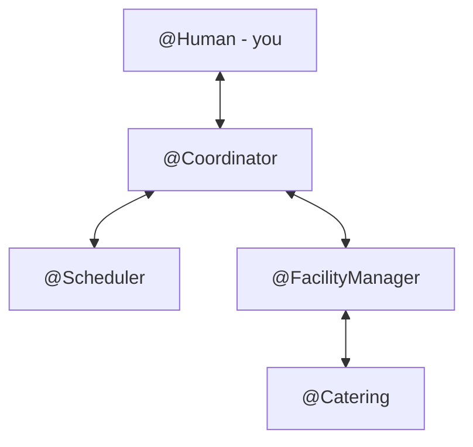
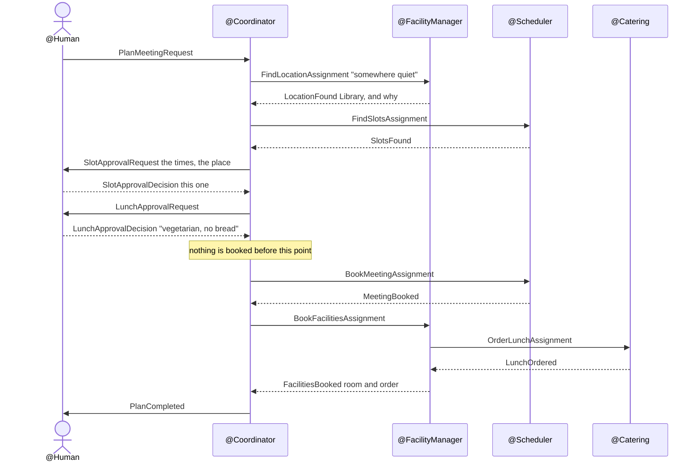

# The team

## What it is

Four agents arrange a meeting together, each with one job:

| Agent | Its job | Reaches |
|---|---|---|
| **`@Coordinator`** | knows the steps and their order, asks you the two questions, keeps the record | nothing - it is plain code |
| **`@Scheduler`** | finds when everyone is free, books the meeting | the meeting service |
| **`@FacilityManager`** | chooses the place, books the room, has lunch arranged | the location service |
| **`@Catering`** | turns *something vegetarian* into an order | the lunch menu |

Three of them use a language model, because their jobs need judgement: matching a description to
a place, a wish to a menu. The fourth, the coordinator, uses no model at all. It is the one that
decides what happens next, and that is not a matter of judgement - the steps of booking a
meeting are known.

You are in the team too, as `@Human`: the coordinator's two questions are messages to you, and
your answers are messages back.

## How it works

### Who talks to whom

The specialists never talk to each other. Everything goes through the coordinator, with one
exception: lunch. `@Catering` sits under `@FacilityManager`, because a room and its lunch go
together, so the coordinator never learns that lunch exists - it asks for *facilities* and gets
back a room and an order. (D2.)

### One meeting, as messages

Agents do not chat. They send each other **typed messages** - a `FindSlotsAssignment` with a day,
a duration and a list of emails; a `SlotsFound` with times - and each agent has a handler for
each kind it receives.

If the request names a location already, choosing one is skipped. If it already says *no
lunch*, the lunch question is.

### Inside a specialist

Every specialist handler has the same shape:

> an assignment comes in → the model is given it, with a **type to answer in** → a typed message
> goes out

The model does the part that needs judgement, with its service's tools: it reads the menu,
calls `book_room`, decides which times to report. But it answers in a fixed shape - a
`ChosenLocation` with an id, a name, a reason and *succeeded* - and it never decides who to tell:
the handler sends the reply. A model that could not do its job says so in `succeeded`, and the
handler turns that into an `AssignmentFailed`, so a failure arrives as a failure, never as a
plausible-looking booking id. An error in the model call - a timeout, a provider failure - is
turned into an `AssignmentFailed` too, so the coordinator is never left waiting.

### The two questions

The coordinator asks you twice, and waits by doing nothing: a question is a message out, and an
answer is a separate message in. There is no thread blocked on you, so it does not matter
whether the answer comes from the browser, the terminal, or a day later from a team that was
stopped and revived.

- **The time**, with the place and why it was chosen. Approving the time approves the place.
  Declining costs nothing, because nothing is booked yet.
- **Lunch**, in your own words. `@Catering` is the only agent that sees the menu, so it is the
  only one that reads your words; *no* means no lunch.

Your answer is checked before it counts. The times travel with the question, so an answer is
just a choice among them - *2*, or *no* for none - and an approval that names no time is refused
rather than read as a no. An answer to a question that is no longer open - a second tab, a late
click - is ignored. The terminal and the browser read answers with the same code, so the same
words mean the same thing in both.

### When a step fails

The coordinator keeps a list of what has been booked so far: the meeting, the room, the order.
If a step fails, it tells you what failed and what is still booked, newest first - the order
in which it would be released. Cancelling later runs that list: the lunch order, then the room,
then the meeting.

## Why it is built this way

**Code where the answer is known, a model where judgement is needed.** Which step follows which
answer, when to ask the human, what to undo after a failure: a model would get these right most
of the time, and *most of the time* is not good enough for something that books rooms and orders
food. In code they are right every time and can be tested like code. The models are kept for what
code cannot do: understanding *somewhere quiet*, or *no bread*. (D1.)

**Irreversible steps are out of a model's hands.** A model never decides that a meeting should
be booked; the coordinator does, after you approved. The specialist's model makes the booking
call, but only when it is given a `BookMeetingAssignment`, and only with its one service's tools.

**Typed messages make the rest possible.** Because every message has fields, a plain-code
coordinator can read them; the browser can show each one as a readable line in the trace; a
test can send one and check the answer; and a model's answer can be checked before anyone acts
on it.

**Nothing is booked before you have answered.** Both questions come before the first booking, so
saying no is free. Lunch is a second question, not a menu: a person wants a say in lunch, not to
pick products. (D4, D9.)

**The arithmetic is not the model's.** Finding a time when four agendas are all free is a
calculation, and models get calculations wrong. The meeting service has a `find_common_slots`
tool that does it; the scheduler's model only decides what to report. (D8.)

**Turned down:** a coordinator that is a model too, routing the work itself. It would be more
flexible and harder to trust, test or explain. Where a model in front of the team *does* help -
holding a conversation - is `@Intake`'s job, and [`design_chat.md`](design/design_chat.md)
Appendix A records why it does not route the work.

## What it does not do

- **Release a failed plan by itself.** A failure reports what is still booked; releasing it is a
  cancel. Whether that should happen on its own is an open question (`design_cancel.md` §8.3).
- **Change a meeting.** Cancel it and plan a new one.
- **Run the agents in parallel.** One step at a time, in order. The saga is short, and order makes
  the trace easy to follow.

## Where in the code

| File | What is there |
|---|---|
| `agents/src/meeting_agents/coordinator.py` | `@Coordinator`: the saga, the two questions, the record |
| `agents/src/meeting_agents/specialists.py` | the three specialists and their handlers |
| `agents/src/meeting_agents/messages.py` | every message the team sends |
| `agents/src/meeting_agents/outputs.py` | the types a model answers in |
| `agents/src/meeting_agents/plan.py` | the meeting's record, and what to undo |
| `agents/src/meeting_agents/answers.py` | reading your answers, for every client alike |
| `agents/catalog/meeting-planner/` | the team, its agents, prompts and tools, as YAML |

The design: [`design_akgents.md`](design/design_akgents.md), with the decisions in §7.

---

*Last checked against the code: 2026-11-03, `234d0f6`.*
